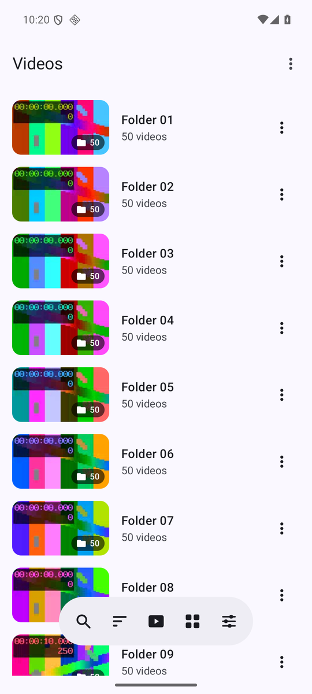
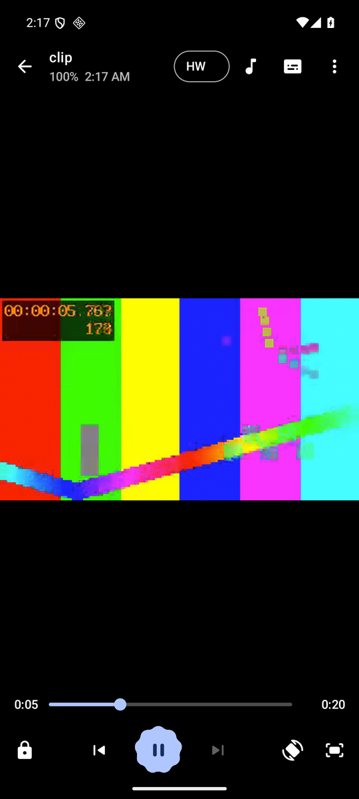
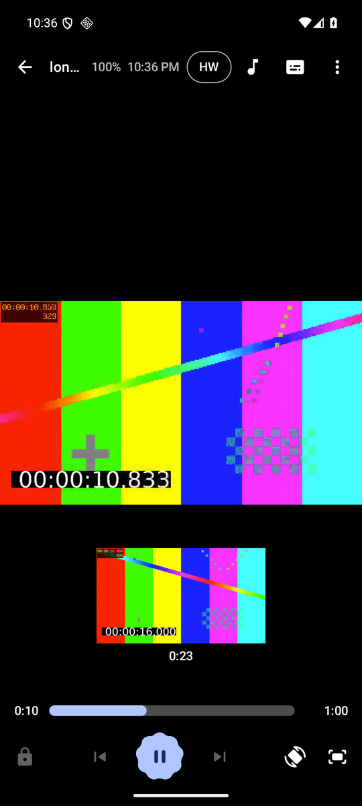
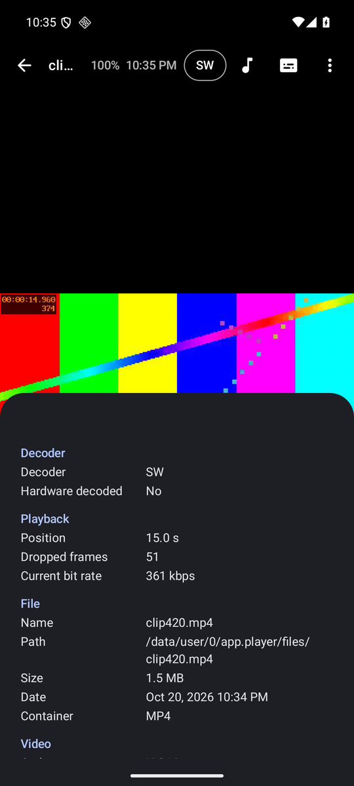
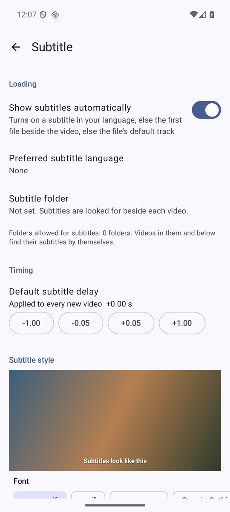
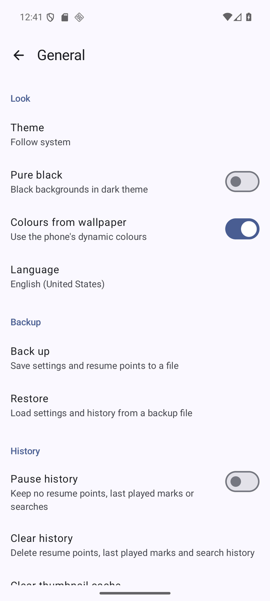

# Lanthorn

Lanthorn is a local-first video player for Android, built on libmpv. It plays the files on your
phone, your SD card and your home network, with hardware decoding, gestures and well-rendered
subtitles. It has no ads, no tracking and no account. It runs on Android 10 and later, targets
Android 16, and is free software under GPL-3.0-or-later.

> **Work in progress.** Not released yet; expect breaking changes. The first release will be
> published under GitHub Releases.

## Features

### Playback

- Hardware decoding first, with automatic fallback to software when the hardware cannot play a
  stream. A badge shows the active decoder (HW, HW+, SW); tap it to switch without losing your place.
- Decoder choice remembered per file, and settable per file extension.
- Info panel: decoder, position, dropped frames, bit rate, file, video, audio and subtitle details.
- Preview frames while you drag the seek bar.
- Speed control with pitch kept, A-B repeat, sleep timer, chapter list and ticks, frame screenshot.
- Plays the rest of the folder in order. Loop one, loop all, shuffle.
- Smart previous (restarts the video first), optional step buttons, optional back-to-list at the end.
- Clear reasons when a file will not play (damaged, missing, no permission, unknown codec).
- Battery and clock in the top bar, screen kept on while playing, back pressed twice to leave,
  a choice of when the controls hide.

### Gestures

- Swipe sideways to seek, up and down for brightness and volume.
- Double tap the sides to skip, the middle to pause. Keep tapping to add steps.
- Hold to play fast, two fingers to change speed.
- Pinch to zoom, drag to pan.
- Each gesture can be turned off.

### Subtitles

- Subtitles load and show by themselves: your language first, then a file beside the video, then
  the file's default track. A subtitle folder can be set.
- Track picker, and opening a subtitle file by hand.
- Encoding detected automatically, or picked by hand. Right-to-left and complex scripts render
  correctly.
- ASS/SSA styling and effects drawn by libass, with an option to override the file's styles.
- Timing: subtitle delay, a default delay for new videos, subtitle speed.
- Style and placement (font, size, colour, outline, shadow, background, alignment, margin) with a
  live preview in settings. Fonts can be added from a folder.
- Online subtitle search, off by default. When you turn it on, it uses your own OpenSubtitles
  account and makes no request until you tap search.

### Audio

- Audio track picker.
- Audio delay, and an Audio settings group.

### Library

- Videos by folder or all in one list, as a list or a grid, with the details you pick.
- Thumbnails loaded lazily and cached. Internal storage and SD cards.
- Sort, search with recent searches, choose which folders and file types are scanned, hide folders
  or videos.
- New, in progress and watched marks, and a one-tap button to resume the last video.
- Select several videos to play them, share them, rename, delete or show their properties. Play
  with a chosen decoder.

### Network

- Play a URL: http, https, rtmp, HLS and DASH. The link on the clipboard is filled in, and
  played links are kept in a history you can edit or turn off.
- Stream errors say why (not found, timeout, unsupported) and offer a retry. Custom user agent.
- Browse and play from SMB 2 and 3 shares. Servers on the network are found for you, or added by
  address. Passwords are stored encrypted with the Android keystore.

### Settings

- Settings search that opens the matching setting.
- Light, dark or pure black theme, colours from the wallpaper, per-app language.
- Back up and restore settings and resume points to a file.
- Pause or clear history, clear the thumbnail cache.

### Privacy

See [Privacy](#privacy) below.

## Screenshots

| Library | Player | Seek preview |
|---|---|---|
|  |  |  |

| Info panel | Subtitle settings | General settings |
|---|---|---|
|  |  |  |

Emulator screenshots with generated test videos.

## Privacy

- The app makes no network request you did not start. No analytics, ads, telemetry, crash
  reporting, update checks or font downloads.
- No account. Everything except the streams and shares you open works offline.
- It asks only for access to videos, and explains why first. On Android 14 and later you can grant
  access to selected videos only. Videos shared from other apps open without any permission.
- No location, camera, contacts, overlay, advertising ID or billing permission.

CI enforces this on every build with a privacy check
([.github/scripts/privacy-check.sh](.github/scripts/privacy-check.sh)). It fails when the release
APK asks for a permission not listed in [.github/privacy/permissions.txt](.github/privacy/permissions.txt),
or ships a library from [.github/privacy/trackers.txt](.github/privacy/trackers.txt). It also lists
any network code outside libmpv.

## Build

JDK 21 and the Android SDK (platform 37) are required.

```
./gradlew assembleDebug        # debug APKs per ABI in app/build/outputs/apk/debug
./gradlew testDebugUnitTest lint
./gradlew assembleRelease      # signed when a release key is configured, see below
```

Release signing reads `keystore.properties` at the repo root (never committed) or the
`PLAYER_KEYSTORE`, `PLAYER_KEYSTORE_PASSWORD`, `PLAYER_KEY_ALIAS`, `PLAYER_KEY_PASSWORD` env vars.
Without them the release APK is unsigned.

libmpv comes as a prebuilt AAR from [hrmasss/libmpv-android](https://github.com/hrmasss/libmpv-android)
releases, pinned by tag in `gradle/libs.versions.toml` and by checksum in
`gradle/verification-metadata.xml`.

## Modules

| Module | What |
|---|---|
| `app` | Entry point, navigation, wiring. Lists the features that add UI to the player. |
| `core/engine` | libmpv wrapper, playback sessions and the video surface. Features use its public API only. |
| `core/player-api` | Extension points for adding panels and menu entries to the player. |
| `core/settings-api` | How a feature adds its settings group to the settings screen and to backups. |
| `core/data` | Persistence (Room, DataStore) and the library index. |
| `core/designsystem` | Theme, tokens and shared components. |
| `core/testing` | Test support: the `@Ears` tag and `evidenceShot()`. Test dependency only. |
| `feature/player` | Player screen, controls, gestures, seek preview, player tools. |
| `feature/info` | Info panel and file properties. |
| `feature/library` | Library, search, file actions, URL dialog, SMB browser, settings screens. |
| `feature/subtitles` | Subtitle loading, tracks, timing, style, online search. |
| `feature/audio` | Audio tracks, delay and audio settings. |
| `feature/playback` | Queue, resume, opening from other apps, failure messages. |
| `bench` | In-app bench mode for the perf harness. Debug and bench builds only, never release. |
| `baselineprofile` | Baseline profile generator and startup benchmark. |
| `build-logic` | Gradle convention plugins. |

A feature never depends on another feature. See [docs/architecture.md](docs/architecture.md) for
the dependency graph, threading and the engine API.

## Testing

- **Unit tests** run on the JVM: `./gradlew testDebugUnitTest`. Compose UI tests in
  `feature/player` run under Robolectric, so they are part of this command.
- **On-device tests** (`androidTest`) run in the `Instrumented` workflow
  ([.github/workflows/instrumented.yml](.github/workflows/instrumented.yml)): each module on its
  own API 36 emulator, in parallel. Results, logcat and screenshots are uploaded as artifacts.
  Locally: `./gradlew :<module>:connectedDebugAndroidTest` with a device or emulator attached.
- **EARS report.** The specs state each requirement as an EARS criterion with an id such as
  `US-17.2`. A test that proves one is tagged `@Ears("US-17.2")`, and can call `evidenceShot("name")`
  to save a screenshot at the moment that proves it (both in `core/testing`). The `EARS` workflow
  ([.github/workflows/ears.yml](.github/workflows/ears.yml)) runs after CI and Instrumented and
  writes one report per commit: each id, its tests, pass or fail, and the screenshots.
- **Performance.** `perf/` measures startup, first frame, dropped frames and seek on a real phone.
  See [perf/README.md](perf/README.md). Emulator numbers are for regressions only.

## Contributing

See [CONTRIBUTING.md](CONTRIBUTING.md).

## Licence

GPL-3.0-or-later. See `LICENSE`. Third-party components and their licences are listed in `NOTICE`.
