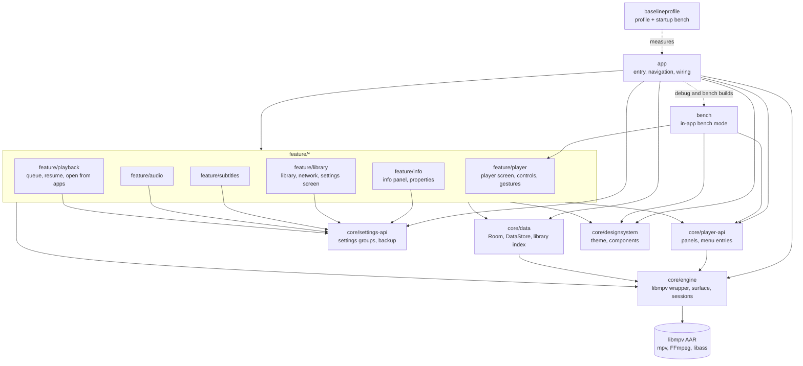
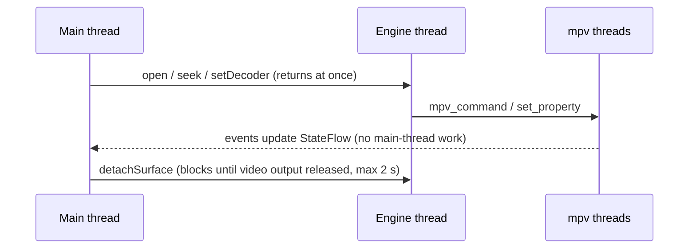

# Architecture

## Modules and dependencies

Drawn from each module's `build.gradle.kts` and the convention plugins in `build-logic`. Every
`feature/*` module uses the `player.feature` plugin, which adds `core/designsystem`, `core/engine`,
`core/player-api` and `core/data`.

`core/testing` (`@Ears`, `evidenceShot()`) is added to every module's unit and on-device tests by
the convention plugins. It is never part of the app.

### Rules

| Rule | Enforced by |
|---|---|
| A feature never depends on another feature. | The `player.feature` convention plugin fails the build. |
| A feature adds UI to the player through `core/player-api`, and `app` lists it in `PlayerApplication`. | Review. |
| Features use `core/engine`'s public API only, never libmpv classes. | libmpv is an `implementation` dependency of `core/engine`, so it is not on a feature's compile classpath. |
| `core/*` never depends on `feature/*` or `app`. | Not on their classpath. |

## Engine threading

- Each engine has one single-thread executor. Every libmpv call goes through it, in order.
- The main thread never waits on libmpv, except for surface teardown, which Android requires to
  finish before `surfaceDestroyed` returns.
- libmpv decodes, demuxes and renders on its own threads. mpv's event thread only writes the
  `StateFlow`.
- One engine per process, shared by the player activity and the playback service. The first holder
  creates it, the last one releases it.
- Video renders into a `SurfaceView` with `vo=gpu-next` and OpenGL ES. Subtitles (libass) and
  filters are drawn in the same pass.

## PlayerEngine public API

The stable surface features build on, in `core/engine`. Anything not listed is internal.

| Member | What it does |
|---|---|
| `PlayerSessions.acquire(context, holder, onCreated)` / `release(holder)` | Gets the one engine per process. Never construct `PlayerEngine` yourself. |
| `PlayerSessions.current` | `StateFlow<PlayerEngine?>`, for the service and notification. |
| `state: StateFlow<PlaybackState>` | Position, duration, paused, buffering, ended, decoder mode and active decoder, video info, dropped frames, first-frame time, error. |
| `open(uri, startMs = 0)` | `content://`, `file://` or a path. Content URIs open as a file descriptor, so no storage permission is needed. |
| `play()`, `pause()`, `togglePause()` | |
| `seekTo(ms, exact = true)` | `exact = false` for keyframe seeks while scrubbing, `true` on release. |
| `setDecoder(DecoderMode)` | `AUTO`, `HW`, `HW_PLUS`, `SW`. Live, keeps the position. |
| `release()` | Frees libmpv. |
| `VideoSurfaceView` | The video surface. Set its `engine`; Compose UIs wrap it in `AndroidView`. |

### Generic property API

Features set their own mpv properties, options and filters. The engine does not add a method per
feature. Names are mpv's: https://mpv.io/manual/stable/#properties

| Member | Example |
|---|---|
| `set(name, value)` for String, Boolean, Long, Double | `engine.set("speed", 1.5)`, `engine.set("sub-delay", -0.2)` |
| `command(vararg args)` | `engine.command("sub-add", path, "select")` |
| `suspend get(name, PropertyType)` | `engine.get("track-list/count", PropertyType.Int64)` |
| `observe(name, PropertyType): StateFlow<T?>` | `engine.observe("sid", PropertyType.Text)` |

- `PropertyType` is `Text`, `Flag`, `Int64` or `Real`.
- All calls are non-blocking and run on the engine thread in order.
- A feature sets only the properties it owns. When two features touch the same filter chain, each
  uses a labelled filter (`@name:`) so neither overwrites the other.

### Player extension points (`core/player-api`)

| Type | Role |
|---|---|
| `PlayerExtension` | A feature's contribution: `panels`, `menuEntries`, `onEngineCreated(context, engine)` for saved settings. |
| `PlayerPanel` | `@Composable Content(host)`. The player screen decides where it goes. |
| `PanelHost` | `engine`, `close()`, `open(panelId)`. |
| `PlayerMenuEntry` | `group` (Video, Audio, Subtitle, Tools), `order`, `opensPanel`, `label`. |
